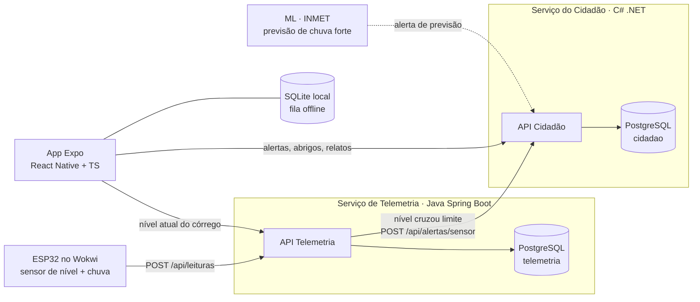

# Olho d'Água — alerta comunitário de alagamentos

> Global Solution 2026.2 · FIAP · Engenharia de Software · CitizenTech

## Ficha da CitizenTech

| Campo | Resposta |
|---|---|
| **Nome** | Olho d'Água |
| **Cidade e bairro** | São Paulo — Jardim Pantanal, São Miguel Paulista (várzea do Rio Tietê) · *placeholder: trocar pelo bairro observado pela equipe* |
| **Cidadão beneficiado** | Morador de área de risco de alagamento — em especial idosos, pessoas com mobilidade reduzida e famílias que moram perto de córregos |
| **Problema, em uma frase** | Quem mora perto de córregos em São Paulo só descobre que a rua vai alagar quando a água já está entrando em casa, sem tempo para proteger pessoas, documentos e bens. |
| **Como funciona** | Sensores de baixo custo medem o nível do córrego e a chuva; quando o nível cruza um limite, o morador inscrito naquela área recebe um alerta no celular com o que fazer e o abrigo mais próximo. Os próprios moradores também reportam alagamentos pelo app, e relatos confirmados viram alerta comunitário. |
| **O que cada parte faz** | **ESP32 (IoT)** mede o nível · **Serviço de Telemetria (Java/SOA)** recebe leituras e detecta limites · **Serviço do Cidadão (C#)** gera alertas, guarda relatos, áreas e abrigos · **App (Expo)** mostra alertas, recebe relatos (funciona offline) e indica abrigos · **ML** prevê chuva forte a partir de dados do INMET · **Linux (SO)** provisiona e monitora os serviços |
| **Link do repositório** | https://github.com/PeOliveira18/GlobalSolution-Mobile |
| **Indicador de impacto** | Minutos de antecedência entre o alerta e o transbordamento · nº de moradores alertados por evento · % de relatos confirmados pela comunidade |
| **ODS conectados** | **ODS 11** (meta 11.5: reduzir mortes e perdas por desastres) · **ODS 13** (meta 13.1: resiliência a riscos climáticos) · **ODS 10** (a população mais exposta é a de baixa renda em áreas de várzea) |

## Arquitetura



**Por que dois serviços:** cada um tem uma responsabilidade clara. A Telemetria só conversa com hardware (muitas leituras, regras de limite). O serviço do Cidadão conversa com pessoas (alertas, relatos, abrigos). Eles se integram por REST: é a parte "orientada a serviços" da entrega de SOA, e deixa as entregas de SOA e C# separadas.

<!-- ESTE-REPO:INICIO -->
## Este repositório: Mobile Development & IOT

Entrega da disciplina **Mobile Development & IOT**: o **app do morador**, em Expo com React Native, TypeScript e Expo Router. Ele mostra o nível do córrego e os alertas da área do morador, recebe relatos de alagamento (salvos no SQLite do celular para funcionar sem internet) e indica os abrigos mais próximos com vaga.

```
GlobalSolution-Mobile/
├── README.md     ← esta Ficha
├── PLANO.md      ← cópia do plano mestre (oficial no repositório Olho-dagua)
├── prompts.md    ← registro do uso de IA
└── app-mobile/   ← código do app (instruções, prints e vídeo no README da pasta)
```
<!-- ESTE-REPO:FIM -->

## Repositórios do projeto

| Parte | Disciplina | Repositório |
|---|---|---|
| Serviço do Cidadão (.NET) | C# Software Development | https://github.com/PeOliveira18/Olho-dagua |
| Serviço de Telemetria (Java) | SOA e Web Services | https://github.com/PeOliveira18/GlobalSolution-SOA |
| App do morador (Expo) | Mobile Development & IOT | https://github.com/PeOliveira18/GlobalSolution-Mobile |

## Plano do projeto

O planejamento completo (contratos entre serviços, portas, dados de seed, o que cada disciplina entrega e o cronograma até 19/11) está em **[PLANO.md](PLANO.md)**.

## Links das entregas

| Disciplina | Link |
|---|---|
| Vídeo do app (Mobile) | *a definir* |
| Projeto Wokwi (IoT) | *a definir* |
| Vídeo IoT | *a definir* |
| Vídeo ML | *a definir* |
| Vídeo Linux (OS) | *a definir* |
| Pitch (Testing) | *a definir* |

## Integrantes

*a preencher*
