# App do morador — Olho d'Água

App em Expo (React Native + TypeScript + Expo Router) da disciplina **Mobile Development & IOT**. A Ficha da CitizenTech está no [README da raiz](../README.md).

É a porta de entrada do morador no Olho d'Água e responde à jornada da Ficha: *"Vai alagar na minha rua? O que eu faço? Para onde eu vou? Como eu aviso os vizinhos?"*. Consome as APIs do Serviço do Cidadão (C#) e do Serviço de Telemetria (Java), ou um mock com os mesmos contratos; guarda os dados no **SQLite** do celular; e funciona **sem internet**.

**🎬 Vídeo do app rodando (2min26s):** https://youtube.com/shorts/bjF2RS14oQQ · cópia no repositório: [docs/video-app.mp4](docs/video-app.mp4) · roteiro em [docs/roteiro-video.md](docs/roteiro-video.md)

## Telas

<table>
  <tr>
    <td align="center">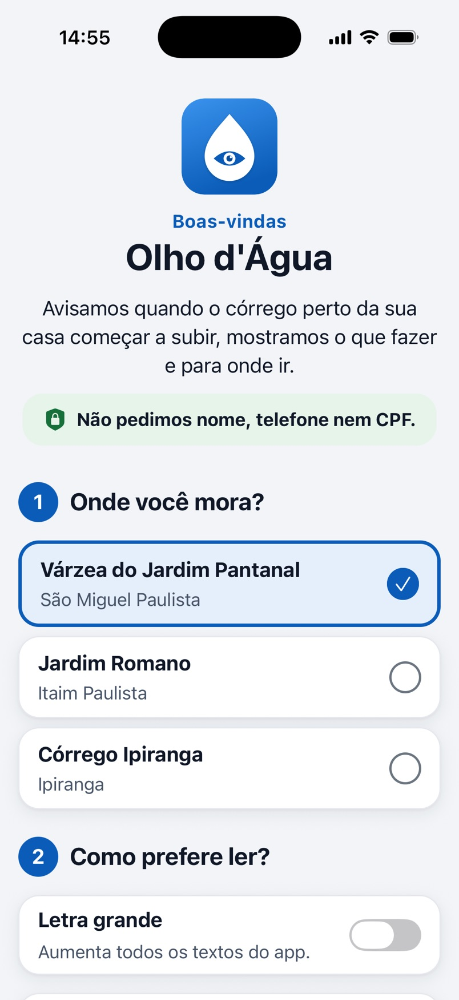<br><b>Onboarding</b></td>
    <td align="center">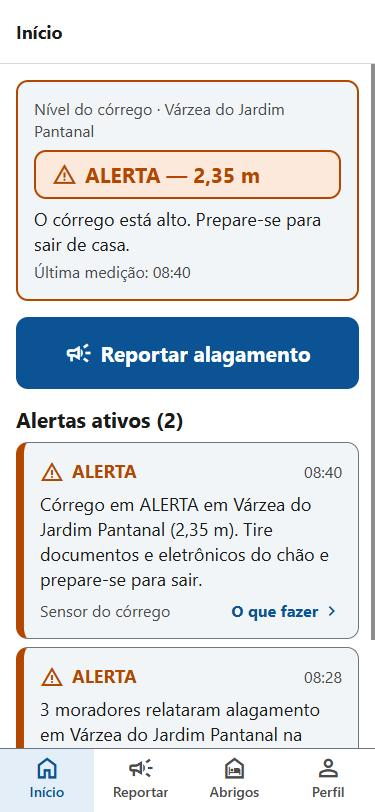<br><b>Início</b></td>
    <td align="center">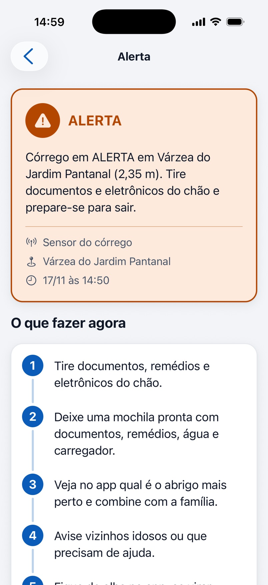<br><b>Detalhe do alerta</b></td>
  </tr>
  <tr>
    <td align="center">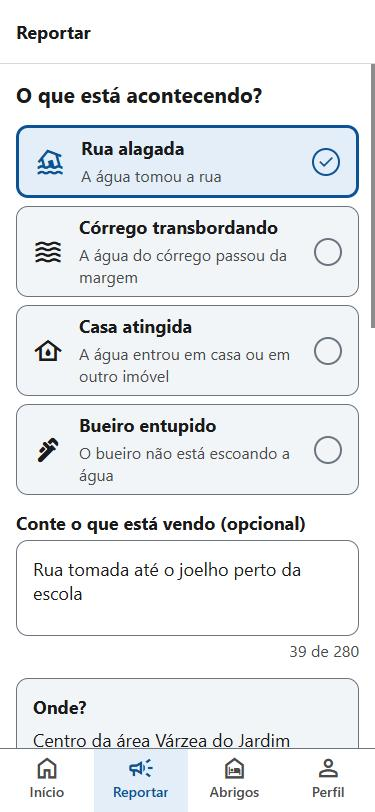<br><b>Reportar</b></td>
    <td align="center">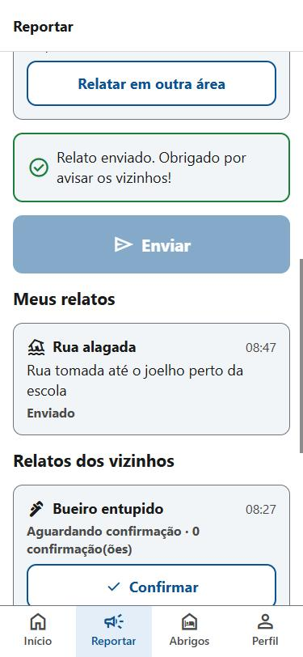<br><b>Meus relatos</b></td>
    <td align="center">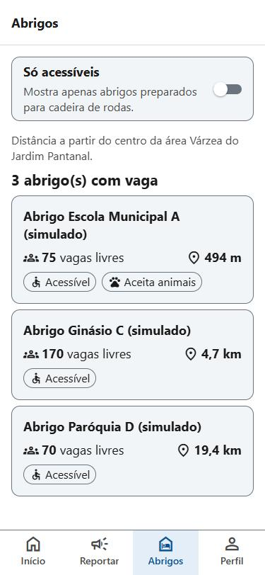<br><b>Abrigos</b></td>
  </tr>
  <tr>
    <td align="center">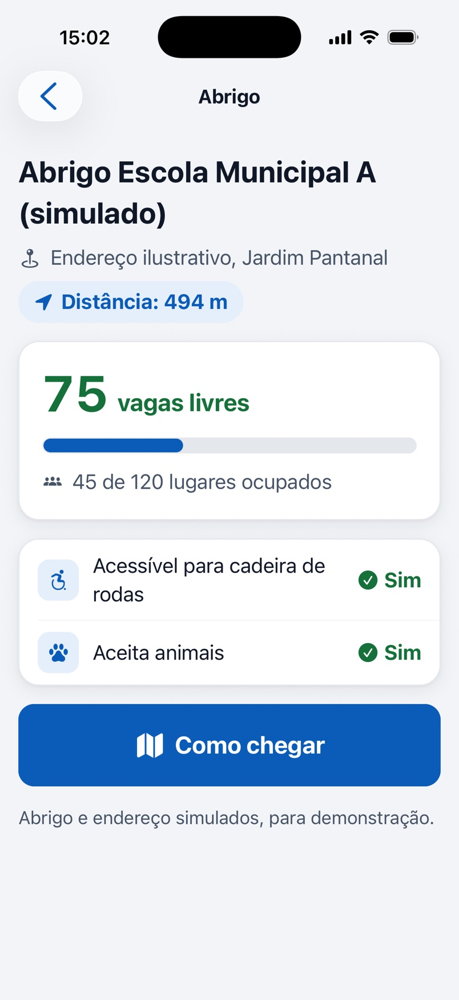<br><b>Detalhe do abrigo</b></td>
    <td align="center">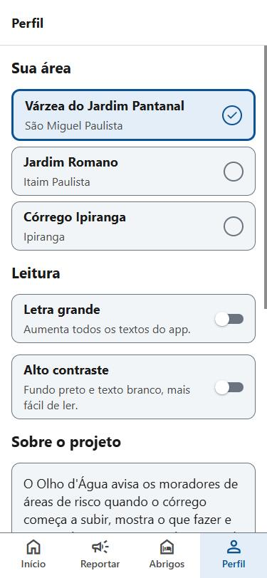<br><b>Perfil</b></td>
    <td align="center">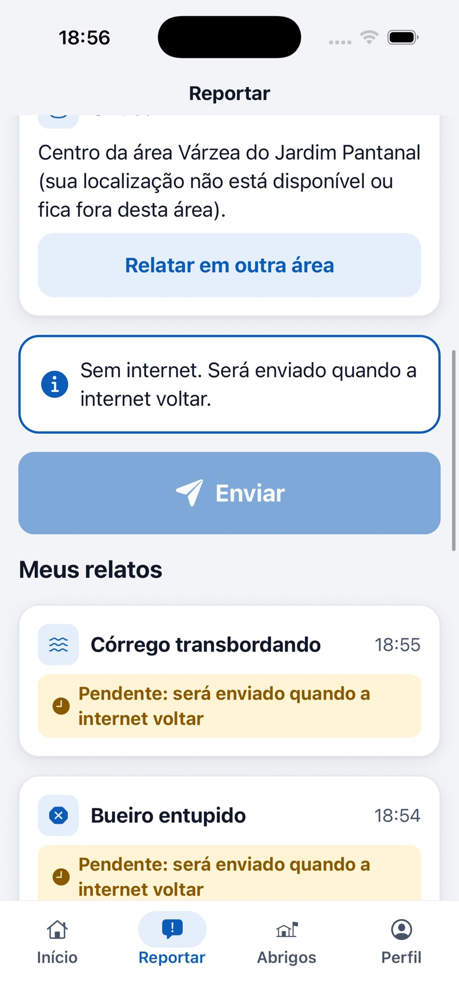<br><b>Relato sem internet</b></td>
  </tr>
  <tr>
    <td align="center">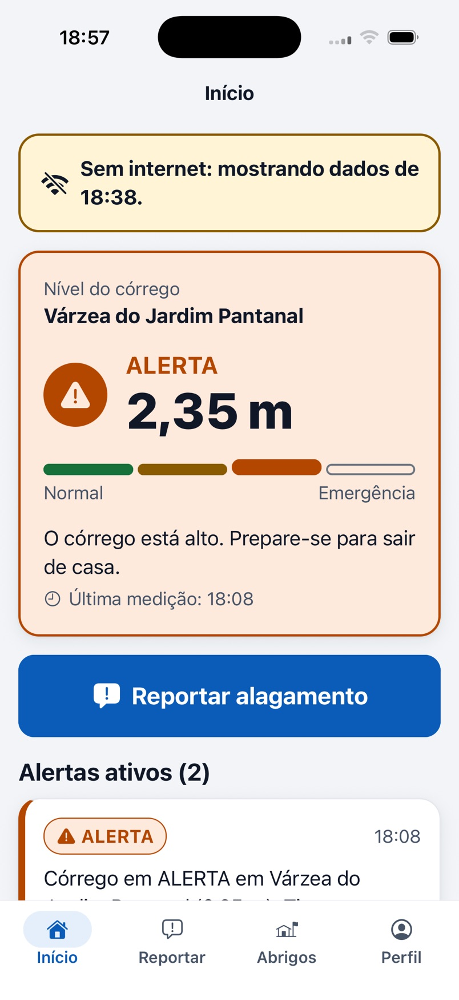<br><b>Início sem internet</b></td>
    <td align="center">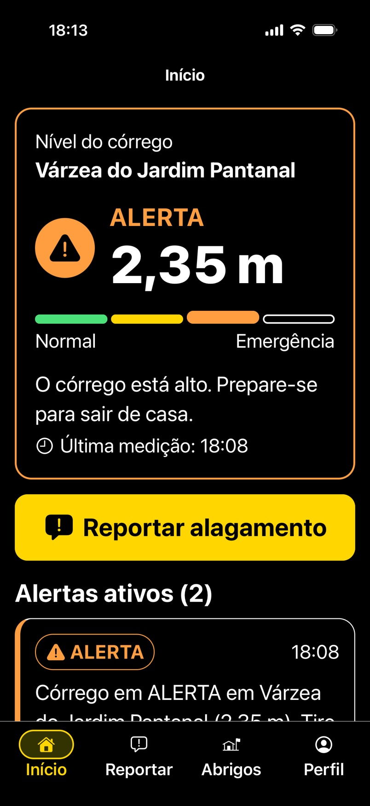<br><b>Alto contraste + letra grande</b></td>
    <td></td>
  </tr>
</table>

Prints tirados no modo mock (dados simulados), no Simulador de iOS (iPhone 17 Pro).

## Como rodar

Pré-requisitos: Node 22.13 ou mais novo e o app **Expo Go** no celular (compatível com o SDK 58).

```bash
cd app-mobile
npm install
npx expo start
```

- **Celular:** leia o QR code com o Expo Go (Android) ou com a câmera (iOS). O celular precisa estar na mesma rede Wi-Fi do computador.
- **Navegador:** aperte `w` no terminal do Expo ou rode `npx expo start --web`.

## Modo mock × API real

Por padrão o app usa **dados simulados** (`src/services/mock/*.json`, com os mesmos dados de demonstração dos backends), então funciona sem nenhum backend no ar.

Para usar os serviços de verdade, copie `.env.example` para `.env`, ajuste e reinicie o `npx expo start`:

| Variável | Para quê | Padrão |
|---|---|---|
| `EXPO_PUBLIC_USE_MOCK` | `true` = dados simulados · `false` = APIs reais | `true` |
| `EXPO_PUBLIC_API_CIDADAO` | URL do Serviço do Cidadão (.NET) | `http://localhost:5080/api` |
| `EXPO_PUBLIC_API_TELEMETRIA` | URL do Serviço de Telemetria (Java) | `http://localhost:8081/api` |

> No celular físico, `localhost` é o próprio celular: use o IP do computador na rede, por exemplo `http://192.168.0.10:5080/api`.

### Rodando com os backends reais (celular na mesma rede)

1. Suba o **Serviço do Cidadão** escutando na rede, com o perfil `lan`, no repositório do C#:
   ```bash
   dotnet run --project src/OlhoDagua.Cidadao.Api --launch-profile lan
   ```
2. Suba o **Serviço de Telemetria**, no repositório do SOA:
   ```bash
   ./mvnw spring-boot:run
   ```
3. Descubra o IP do computador (`ipconfig` no Windows) e crie o `app-mobile/.env`:
   ```
   EXPO_PUBLIC_USE_MOCK=false
   EXPO_PUBLIC_API_CIDADAO=http://SEU_IP:5080/api
   EXPO_PUBLIC_API_TELEMETRIA=http://SEU_IP:8081/api
   ```
4. Reinicie o `npx expo start` e abra no Expo Go. Se o celular não alcançar o computador, libere as portas 5080 e 8081 no firewall do Windows para a rede privada.

**Erros tratados:**
- cada chamada espera no máximo 10 s;
- sem resposta ou erro 5xx, o relato fica na fila e o Início mostra o último dado guardado, com o banner "Servidor indisponível" ou "Sem internet";
- erros de validação (400) mostram a mensagem do servidor em linguagem simples;
- se só um dos serviços cair, o outro continua aparecendo.

As telas sempre chamam `api` (em `src/services/api.ts`). A implementação real (`apiReal.ts`) e a mock (`mock/apiMock.ts`) seguem a mesma interface (`contrato.ts`), então trocar a flag não muda nada nas telas.

## Estrutura do projeto

```
src/
├── app/                     ← rotas do Expo Router (só apontam para as telas em screens/)
│   ├── _layout.tsx          ← layout raiz (Stack) e provedores
│   ├── onboarding.tsx
│   ├── (tabs)/              ← _layout.tsx com as 4 abas + index, reportar, abrigos, perfil
│   ├── alerta/[id].tsx
│   └── abrigo/[id].tsx
├── screens/                 ← telas
│   ├── onboarding/OnboardingScreen.tsx
│   ├── inicio/InicioScreen.tsx
│   ├── alertas/AlertaDetalheScreen.tsx
│   ├── reportar/ReportarScreen.tsx
│   ├── abrigos/AbrigosScreen.tsx · AbrigoDetalheScreen.tsx
│   └── perfil/PerfilScreen.tsx
├── components/              ← Botao, Cartao, CartaoNivel, CartaoAlerta, CampoTexto, OpcaoRadio, Tela...
├── contexts/                ← TemaContext, MoradorContext, ConexaoContext, DadosLocaisContext
├── hooks/                   ← useCarregar, useAreas, usePontoDePartida
├── services/                ← api.ts (ponto único), apiReal.ts, http.ts, mock/, storageService.ts (AsyncStorage),
│                              databaseService.ts e relatoStorage.ts (SQLite), relatoService.ts, localizacaoService.ts
├── themes/                  ← theme.ts: paletas claro e alto contraste, espaçamentos e faixas
├── constants/               ← rótulos dos contratos e passo a passo dos alertas
├── types/                   ← tipos espelhando os contratos das APIs do Cidadão e da Telemetria
└── utils/                   ← distância (Haversine), datas, formatação e confirmação
```

## Jornada do morador

| Pergunta | Tela |
|---|---|
| Vai alagar na minha rua? | **Início**: nível do córrego com cor + ícone + texto e alertas ativos (puxe para atualizar) |
| O que eu faço? | **Detalhe do alerta**: mensagem e passo a passo numerado, atalho para abrigos e para a Defesa Civil (199) |
| Para onde eu vou? | **Abrigos**: com vaga, do mais perto ao mais longe, filtro "Só acessíveis"; detalhe com **Como chegar** |
| Como eu aviso os vizinhos? | **Reportar**: 4 tipos, descrição (até 280 caracteres), localização automática ou centro da área, "Meus relatos" e confirmação dos relatos dos vizinhos |

## Armazenamento local: AsyncStorage e SQLite

**Preferências no AsyncStorage** ([`storageService.ts`](src/services/storageService.ts)): área escolhida, `dispositivoId` anônimo, letra grande, alto contraste, relatos já confirmados e a lista de áreas. Tudo é carregado ao abrir o app.

**Banco de dados no SQLite** (**expo-sqlite**, em [`databaseService.ts`](src/services/databaseService.ts) e [`relatoStorage.ts`](src/services/relatoStorage.ts)), com duas tabelas:

| Tabela | O que guarda |
|---|---|
| `relatos` | os relatos feitos neste celular (`id_local`, `area_risco_id`, tipo, descrição, lat/lon, `criado_em`, `status_sync` = `PENDENTE` · `ENVIADO` · `ERRO`, `id_servidor`) |
| `cache_status` | a última tela Início que carregou (nível + alertas) de cada área, com a hora |

**Fila offline:** todo relato é gravado primeiro no SQLite como `PENDENTE` e só depois enviado. Sem internet, ele espera na fila, e a tela avisa "Será enviado quando a internet voltar". Os pendentes são enviados:

1. ao abrir o app;
2. quando a internet volta (`@react-native-community/netinfo`);
3. ao puxar a tela para atualizar.

O `idLocalApp` do relato garante que reenviar não cria duplicata no servidor. Sem internet, o Início mostra o banner **"Sem internet: mostrando dados de HH:MM"** com o que estava guardado.

> No modo mock, o "sem internet" do netinfo também faz o mock falhar como um servidor fora do ar, para a fila poder ser demonstrada sem os backends.
>
> No navegador, o SQLite roda em WebAssembly e precisa dos cabeçalhos configurados em `metro.config.js`.

## Acessibilidade

- Todo elemento tocável tem nome, papel e dica para o TalkBack/VoiceOver; áreas de toque com pelo menos 48 × 48 dp.
- A faixa do córrego e a gravidade dos alertas aparecem sempre com **cor + ícone + texto**.
- **Letra grande** (1,3×, somada à escala do sistema) e **alto contraste** (fundo preto, texto branco, bordas) no Perfil e no onboarding.
- Alerta novo é falado pelo leitor de tela (`announceForAccessibility`); avisos e erros usam regiões "ao vivo".
- Linguagem simples: "nível do córrego", nunca "telemetria".

**Auditoria automática (16/11/2026):** em todas as telas (onboarding, 4 abas, detalhe do alerta e do abrigo), nos temas padrão e alto contraste com letra grande, nenhum elemento tocável sem nome, nenhum alvo menor que 48 × 48 e nenhum texto abaixo do contraste AA. A auditoria encontrou e corrigiu o botão "Voltar" do cabeçalho (era 30 × 30 e lido como "Voltar, back").

**Roteiro para testar com o TalkBack** (Android: Configurações → Acessibilidade → TalkBack):
1. Na 1ª abertura, deslize para a direita: as áreas são lidas como "opção", com o estado "selecionado".
2. Em "Letra grande", toque duas vezes: o leitor anuncia "interruptor, ativado".
3. No Início, o cartão de nível é lido como "Nível do córrego: Alerta, 2,35 m".
4. Cada alerta é lido com a gravidade, a mensagem e a dica "Abre o passo a passo do que fazer agora".
5. No detalhe, cada passo é lido como "Passo 1 de 5: …".
6. No Reportar, com mais de 280 caracteres, o leitor anuncia "Máximo de 280 caracteres", e o Enviar fica "desativado".
7. Puxe o Início para atualizar quando houver um alerta novo: o leitor fala "Novo alerta: …".

## Critérios de avaliação → onde está

| Critério | Onde está no projeto |
|---|---|
| **Telas e navegação** | Expo Router em [`src/app/`](src/app) (Stack raiz com onboarding obrigatório na 1ª abertura, 4 abas com ícone + texto e as rotas dinâmicas `alerta/[id]` e `abrigo/[id]`); as telas ficam em [`src/screens/`](src/screens) |
| **Consumo de dados** | [`src/services/`](src/services): interface única [`contrato.ts`](src/services/contrato.ts) com implementação HTTP ([`apiReal.ts`](src/services/apiReal.ts), [`http.ts`](src/services/http.ts), timeout e ProblemDetails) e mock ([`mock/`](src/services/mock)), escolhidas por `EXPO_PUBLIC_USE_MOCK`. Tipos em [`src/types/`](src/types), iguais aos DTOs reais. Testado contra as APIs reais do C# e da Telemetria |
| **Banco de dados** | expo-sqlite em [`databaseService.ts`](src/services/databaseService.ts) e [`relatoStorage.ts`](src/services/relatoStorage.ts): tabelas `relatos` e `cache_status`, com versão de esquema; preferências no AsyncStorage ([`storageService.ts`](src/services/storageService.ts)); fila offline e sincronização em [`MoradorContext.tsx`](src/contexts/MoradorContext.tsx) |
| **Acessibilidade** | Seção acima: [`components/`](src/components) com nome, papel e dica; [`TemaContext.tsx`](src/contexts/TemaContext.tsx) e [`themes/theme.ts`](src/themes/theme.ts) com letra grande, alto contraste e faixas com cor + ícone + texto |
| **Aderência ao problema** | A jornada da Ficha ponta a ponta, o passo a passo de enchente em [`constants/orientacoes.ts`](src/constants/orientacoes.ts) e o relato que funciona sem internet (quando chove forte, a rede costuma cair) |
| **Documentação** | Este README e o roteiro do vídeo |

## Dados

Todos os dados são **simulados** (áreas, abrigos, sensores e alertas são os mesmos dados de demonstração dos backends): nenhum dado pessoal real. O app não pede nome, telefone nem CPF; o celular é identificado por um código aleatório (`dispositivoId`).
